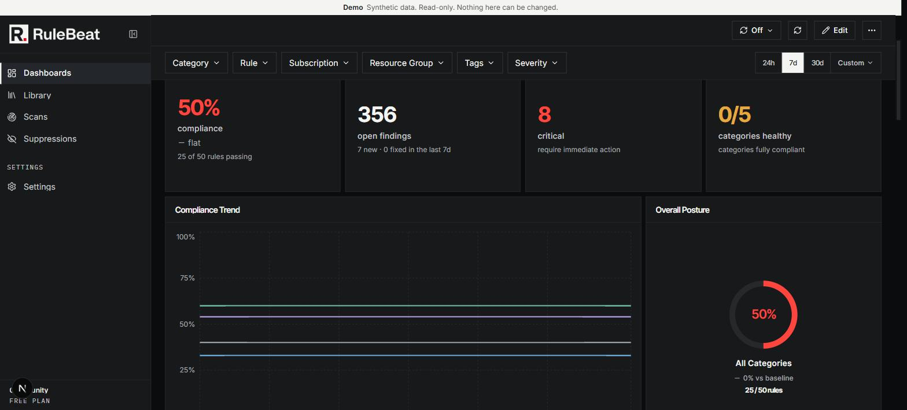

# Dashboards

The widget catalog, filters, date windows, and how to present or print a dashboard. If the question is what "7 of 12" means, read
[`posture.md`](posture.md) first.

Every widget reads live state from the findings table plus, for trend lines, the daily posture
snapshots. No widget reads the last scan's result blob, so a narrow scheduled run cannot make a
dashboard swing. Suppressed findings are excluded everywhere on a dashboard; the Scans page is where
you see them.

## The widget catalog

<!-- count:widget-types -->Thirteen widget types, added from the Add Widget panel:

| Widget | Shows |
|---|---|
| **Stat Card** | One number from a metric you pick: posture, open findings, critical, high, rules scanned, categories healthy, new or fixed. Carries the window's delta and any unknown count. |
| **Posture Ring** | The "X of Y passing" gauge for one category or overall, with "N not yet proven" underneath. |
| **Trend Chart** | Posture % over time, one series per category. Needs stored history. |
| **Top Violating Rules** | The rules producing the most open findings. |
| **Category Scorecard** | One row per category: passing, open findings, delta. |
| **Recent Findings** | The newest findings, with category, severity and first-seen date. |
| **Severity Breakdown** | A donut of open findings by severity. |
| **Subscription Scorecard** | One row per subscription, graded against the rules that apply to it. |
| **Top Offending Resources** | The resources with the most open findings. |
| **Scan Coverage** | Last scan time per category, badged fresh, recent, stale or never against your threshold. |
| **New vs. Fixed** | Findings first seen against findings fixed, per day. |
| **Activity Occurrences** | Daily findings from activity rules. Empty until the Log Analytics backend lands. |
| **Advisories** | Open Advisories with rule, resource, severity and when each was last seen, most severe first and then most recently seen. Advisories are never counted as problems, so this is the one widget that lists them. A row opens the Advisories tab on Scans. |

Widgets showing findings or rules click through to the Scans page with the same filters applied, so
the list you land on is the list the number counted.

## Filters and scope

A dashboard has one filter bar applied to every widget: categories, subscriptions, resource groups,
tags, severities, rules, and a date window. A funnel indicator appears on the bar and on each widget
title while a filter is active, so a scoped number never looks global. Tags here are **rule** tags
(labels like `framework:iso27001`), not Azure resource tags.

Each widget also has a **Scope** panel with the same dimensions. A value set there **replaces** the
dashboard's value for that dimension on that widget; anything left on inherit takes the dashboard's.
Values never intersect, so if the dashboard is filtered to production and a widget's Scope names the
sandbox subscription, that widget shows the sandbox.

The date window is a rolling preset (24 hours, 7 or 30 days) or a custom range. A preset is stored as
"7 days" rather than two dates, so it keeps rolling. It drives anything that says new, fixed or
delta, the Trend and New vs. Fixed charts, and "vs baseline". It does not change what counts as open.

Three limits a widget will tell you about. Trend needs snapshots at the right grain, so under a
resource group, tag, severity or rule filter, or with two or more subscriptions selected, it says a
trend is not available rather than drawing a misleading blended line
([`posture.md`](posture.md#snapshots-and-trend)); the open-findings delta keeps working under every
filter. A failed data request shows "Couldn't load this widget" with a Retry, while genuinely absent
data shows an empty state, so a broken dashboard cannot pass for a clean tenant. And no enabled
rules in scope shows an empty posture rather than 0% or 100%.

## Managing dashboards

Create a blank dashboard, duplicate one for a per-team variant, rename, delete, set the default, or
Restore starter to recreate the seeded Overview layout. Every dashboard is deletable including the
default; deleting it promotes the oldest remaining one. Layouts save per dashboard. Creating,
renaming and deleting is audited; dragging and resizing is not, since every drag would be an entry
and would bury real changes. Viewers see every dashboard, editing needs the editor role
([`rbac.md`](rbac.md)).

## Present and print

A dashboard leaves your own screen two ways: Present, for a screen on a wall, and paper. Both show the
dashboard as you see it, under your own Access, and both carry the same stamp.

### Present

Present opens a dashboard at `/dashboards/<id>/present`, read-only and full screen. There is nothing
to edit and no filter bar. Every number is still a link to the same count on Scans, so a person
standing at the screen with a keyboard or a mouse can follow it.

Present refreshes on its own. Each tick reloads the layout and the numbers, so a widget added or
moved since the last tick appears without anyone touching the screen. The interval is, in order:

1. `?refresh=` on the address, when it holds one of `30s`, `1m`, `5m`, `15m`, `30m` or `1h`. Anything
   else falls back to the next rule. It applies to this screen only and is never saved.
2. The dashboard's own refresh interval.
3. Every 5 minutes, when the dashboard's interval is Off.

### The stamp

The stamp is a band on Present and on paper. It says whose view this is, so a screenshot or a printout
cannot pass for the whole install. Each cell:

| Cell | Shows |
|---|---|
| **As seen by** | The person who is signed in. |
| **Access** | Their Access as counts by kind (for example subscriptions and resource groups), or Everything. |
| **Filters** | The filters they hold on this dashboard, plus "+N outside your access" for values held back from them because they sit outside their Access. On screen a long list is cut to the first few and ends "and N more". |
| **Updated** | When the numbers were last loaded. |
| **Widgets** | How many widgets are unavailable. A widget that failed to load is counted here, so a blank tile is never mistaken for a clean result. |
| **Refreshes every** | The interval Present is using, as set out above. |

### The Everything notice

When an Admin, or anyone holding Everything, presents a dashboard, Present shows a notice that the
screen shows every finding on the install. It does not block anything. A person whose Access is narrower never sees it. It does not appear in the Demo.

### When Present cannot show the dashboard

Present never leaves the last picture up as if it were current without saying so.

- **Signed out.** The session ended. Present says so and offers sign-in; signing in returns you to
  the same dashboard.
- **Forbidden.** You are signed in but can no longer open this dashboard, because it stopped being
  shared with you or your Access changed. Present clears the dashboard rather than keep showing
  numbers you are no longer allowed to see.
- **Unavailable.** The dashboard no longer exists, or RuleBeat could not be reached. Present says
  which, rather than showing an empty dashboard.
- **Not updated since.** A refresh that fails for a passing reason, such as a network drop, keeps the
  last numbers on screen and adds "Not updated since" with the time of the last good refresh. The next
  tick that succeeds removes it.

### Print

Use the **Print** action on a dashboard, or Ctrl+P (Cmd+P on a Mac). The page is restyled for paper:
no navigation or controls, the grid kept in place, and the stamp at the top. Landscape fits the grid
best. Safari users choose landscape in the print dialog themselves.

One exception. The Print action and Ctrl/Cmd+P resize the charts to the page before the dialog opens.
Printing from the browser's own Print menu skips that step, so charts print at their screen size and
may be cropped or small. Use the action or the shortcut for paper.

## A screen on the wall

A wall screen is a person like any other, signed in on a screen. There is no screen account, and no
link-only or embed access: every request is made by someone signed in, and the dashboard is refused to
anyone who is not.

1. **Invite a dedicated person.** Make them a Viewer with Manual access to only that team's Scopes, so
   the screen shows what the team is allowed to see and nothing more. How to pick the Scopes is under
   [Manual access](access.md#manual-access).
2. **Sign them in** however the install's sign-in policy allows: a local account or Microsoft sign-in.
3. **Open Present** for the dashboard on that screen. Add `?refresh=` if the default interval is wrong
   for it.

The session is the ordinary sliding one, renewed by each refresh. It lasts for as long as the screen
keeps refreshing, so a working screen stays signed in. If it does lose the session, it shows the
signed-out screen above and someone has to sign in again.

Present can't put the browser in full screen by itself after a reload. On a dedicated screen, start
the browser in kiosk mode: `--kiosk` for Chrome or Firefox.

A touch screen should run in kiosk mode, since a stray tap leaves Present and only someone with a
keyboard can undo it.
