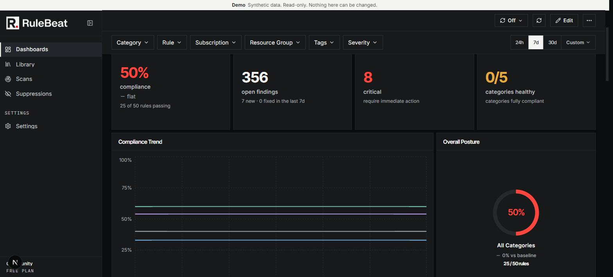

# Dashboards

The widget catalog, filters and date windows. If the question is what "7 of 12" means, read
[`posture.md`](posture.md) first.

Every widget reads live state from the findings table plus, for trend lines, the daily posture
snapshots. No widget reads the last scan's result blob, so a narrow scheduled run cannot make a
dashboard swing. Suppressed findings are excluded everywhere on a dashboard; the Scans page is where
you see them.

## The widget catalog

<!-- count:widget-types -->Thirteen widget types, added from the Add Widget panel:

| Widget | Shows |
|---|---|
| **Stat Card** | One number from a metric you pick: posture, open findings, critical, high, rules scanned, categories healthy, new or fixed. Carries the window's delta and any unknown count. |
| **Posture Ring** | The "X of Y passing" gauge for one category or overall, with "N not yet proven" underneath. |
| **Trend Chart** | Posture % over time, one series per category. Needs stored history. |
| **Top Violating Rules** | The rules producing the most open findings. |
| **Category Scorecard** | One row per category: passing, open findings, delta. |
| **Recent Findings** | The newest findings, with category, severity and first-seen date. |
| **Severity Breakdown** | A donut of open findings by severity. |
| **Subscription Scorecard** | One row per subscription, graded against the rules that apply to it. |
| **Top Offending Resources** | The resources with the most open findings. |
| **Scan Coverage** | Last scan time per category, badged fresh, recent, stale or never against your threshold. |
| **New vs. Fixed** | Findings first seen against findings fixed, per day. |
| **Activity Occurrences** | Daily findings from activity rules. Empty until the Log Analytics backend lands. |
| **Advisories** | Open Advisories with rule, resource, severity and when each was last seen, most severe first and then most recently seen. Advisories are never counted as problems, so this is the one widget that lists them. A row opens the Advisories tab on Scans. |

Widgets showing findings or rules click through to the Scans page with the same filters applied, so
the list you land on is the list the number counted.

## Filters and scope

A dashboard has one filter bar applied to every widget: categories, subscriptions, resource groups,
tags, severities, rules, and a date window. A funnel indicator appears on the bar and on each widget
title while a filter is active, so a scoped number never looks global. Tags here are **rule** tags
(labels like `framework:iso27001`), not Azure resource tags.

Each widget also has a **Scope** panel with the same dimensions. A value set there **replaces** the
dashboard's value for that dimension on that widget; anything left on inherit takes the dashboard's.
Values never intersect, so if the dashboard is filtered to production and a widget's Scope names the
sandbox subscription, that widget shows the sandbox.

The date window is a rolling preset (24 hours, 7 or 30 days) or a custom range. A preset is stored as
"7 days" rather than two dates, so it keeps rolling. It drives anything that says new, fixed or
delta, the Trend and New vs. Fixed charts, and "vs baseline". It does not change what counts as open.

Three limits a widget will tell you about. Trend needs snapshots at the right grain, so under a
resource group, tag, severity or rule filter, or with two or more subscriptions selected, it says a
trend is not available rather than drawing a misleading blended line
([`posture.md`](posture.md#snapshots-and-trend)); the open-findings delta keeps working under every
filter. A failed data request shows "Couldn't load this widget" with a Retry, while genuinely absent
data shows an empty state, so a broken dashboard cannot pass for a clean tenant. And no enabled
rules in scope shows an empty posture rather than 0% or 100%.

## Managing dashboards

Create a blank dashboard, duplicate one for a per-team variant, rename, delete, choose the defaults, or
Restore starter to recreate the seeded Overview layout. Layouts save per dashboard. Creating,
renaming and deleting is audited. Saving a Shared dashboard is audited too (see below), but dragging
and resizing a Personal one is not, since every drag would be an entry and would bury real changes.

### Personal and Shared

Every dashboard is **Personal** or **Shared**, and has an owner. Anything you make is Personal: a new
dashboard, a Duplicate, one made from a template, and Restore starter. A Personal dashboard is yours
alone. Anyone else, an Admin included, gets "not found" for it, in the address bar and from the API.
Everyone signed in can keep Personal dashboards, a Viewer and a person with no Scope too.

A Shared dashboard opens at `/dashboards/<id>` for anyone signed in, each person seeing what their own
access allows. A person who holds no Scope sees a message that they have been given no access in place of the widgets, since every widget would read empty. Its owner can change it if they are an Editor. An Admin, or an Editor on Everything, can
change any Shared dashboard, including one with no owner (every dashboard from before owners has none).
Anyone who can open a dashboard can Duplicate it: the copy is a Personal dashboard of their own, it is
never the default, and its widgets keep any saved view they point at.

The gallery has two sections. **Yours** lists everything you own, each tagged Personal or Shared.
**Shared by others** lists the Shared dashboards you do not own, with the owner's name, or their email
when they have no name yet, or "No owner". Your own Shared dashboards appear only under Yours.

**Share** (in the More menu on the dashboard, and in the gallery's card menu) makes your own Personal
dashboard Shared. It first asks: "Share <name> with everyone on this install? Its name, description,
widget titles and search text will be visible to everyone, and its name will appear in the audit log."
Only the owner shares, and only with an Editor Role at some Scope. A Viewer, and an Editor who holds no
Scope, see Share switched off with "Sharing needs an Editor Role at some Scope." Sharing checks the names
of Shared dashboards across the install and answers 409 when the name is taken. **Unshare** makes a Shared
dashboard Personal again, to its owner. The owner can unshare their own; an Admin, or an Editor on
Everything, can unshare any Shared dashboard. If the owner has a Personal dashboard with the same name,
the owner's own unshare is refused with 409. Someone else's unshare never fails on a clash: the dashboard
takes the next free name in the owner's Personal list (for example "Overview (2)"), and the answer does
not say what that name is. A dashboard with no owner cannot be unshared: "Take this over before unsharing
it." Unsharing the Install default leaves the install without one. Each share and unshare moves the
dashboard's revision on, and one the dashboard's current state no longer allows (someone shared or
unshared it since the page loaded) answers 409 and asks you to reload.

If your access no longer lets you change a Shared dashboard you own, the page says "Your access no longer
lets you change Shared items. Duplicate it, or ask an Admin to take it over."

A name is unique among your own Personal dashboards, whatever its case or surrounding spaces, and nobody
else's Personal names are ever checked, so a clash never tells you what someone else keeps. Renaming a
Shared dashboard checks the names of Shared dashboards across the install. A clash answers 409. Names
that already clash from before keep working.

### The two defaults

There are two defaults, and neither is picked for you.

The **Install default** is one Shared dashboard chosen by an Admin or an Editor on Everything, from the
Shared dashboards: "Set as Install default" in the card menu on the gallery or the More menu on the
dashboard. A Personal dashboard cannot be it (the answer is 409: share it first). Only an Admin or an
Editor on Everything can unshare or delete the Install default, and they choose it, so its owner, if
they are an Editor on a smaller Scope, can still edit what is in it but sees Unshare and Delete switched
off with the reason. Choosing a dashboard is not a save: a dashboard save that sends `isDefault` is
refused with 400.

**My default** is the dashboard you open first. Anyone signed in can pick one: their own Personal
dashboard or any Shared one ("Make my default" in the same menus). It is yours alone, nobody else sees it
and it is not audited.

The Dashboards link (`/dashboard`) opens My default, then the Install default, then the gallery. Nothing
becomes the default by being first or by being the oldest left, so deleting or unsharing the Install
default leaves the install without one until an Admin or an Editor on Everything chooses another. There is
no automatic promotion. With no Install default the gallery says so, and offers whoever may choose one a
way to do it.

If your My default stops being available to you (it was deleted, unshared by someone else, or is no
longer one you can open), it is cleared and the next time you open the Dashboards link you land on the
Install default or the gallery with one line saying so. You are told once. The redirect never saves a
choice for you.

The gallery and the tab strip mark the Install default and your My default.

Creating, renaming and deleting a Personal dashboard is audited by its id and kind only, with no name.
Sharing writes `dashboard.share` and unsharing `dashboard.unshare`, each naming the dashboard (an unshare
with the name it had while Shared). Choosing the Install default, and losing it by an unshare or a delete,
write `dashboard.install_default`. Each save of a Shared dashboard writes one entry that names it and the
fields that changed (name, description, filters, widgets, layout), never their values.
Removing a person deletes their Personal dashboards and leaves their Shared ones Shared with no owner
([`rbac.md`](rbac.md)).
