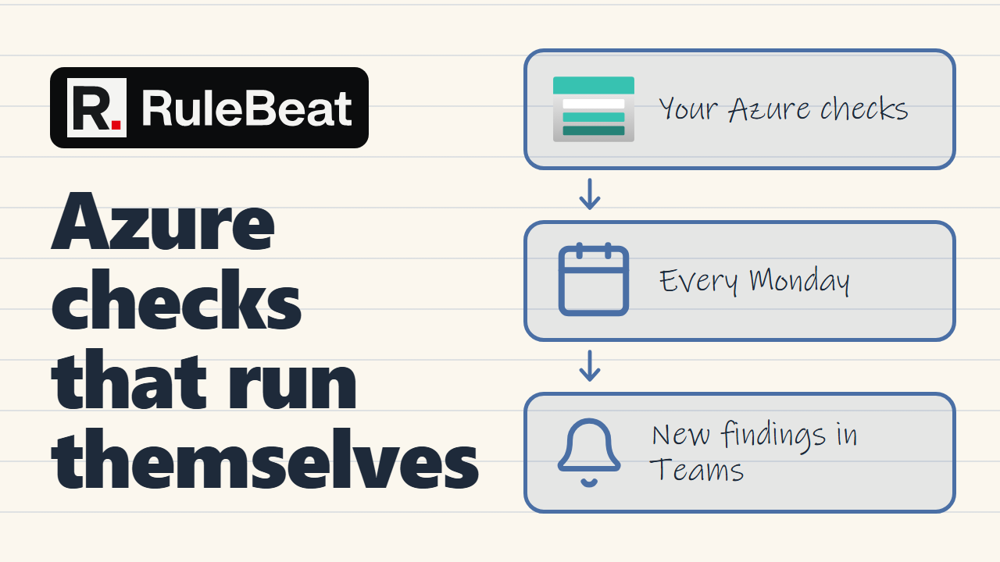
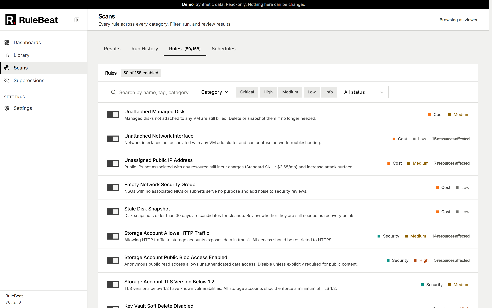
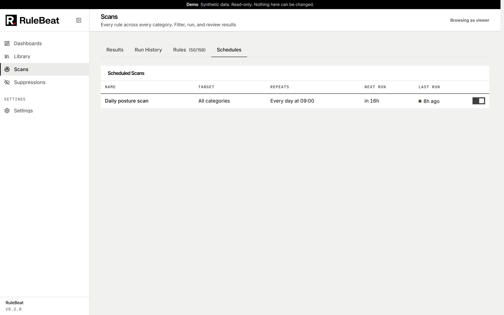
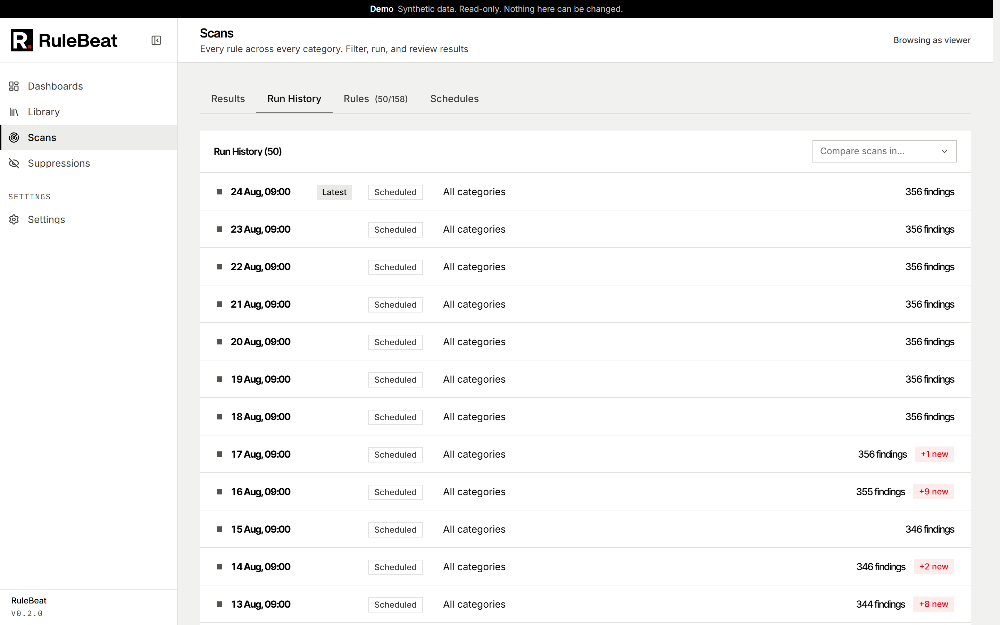

# Scans and schedules

Everything scan-related lives on one Scans page, under six tabs: **Results** (current Problems,
filterable by category, severity, status and more), **Advisories** (findings of Advisory rules),
**Activity** (findings of Log Analytics rules), **Run History** (every past run and its coverage),
**Rules** (every rule with its enabled state and last outcome), and **Schedules**. Category is a
filter on each tab, not a separate page.

<!-- tutorial:scheduled-checks (generated by the tutorial publish sync from the series feature index; edit the index, not this block) -->

▶ **Watch:** [The check you keep running by hand](https://youtu.be/5jAe6CuMO1M), 2 min.

<!-- /tutorial:scheduled-checks -->

Each finding is listed on exactly one of the first three tabs, by its rule's kind, so the Results
table lists the same findings its tiles count. An Activity finding is something that happened, not
something still wrong: it is never fixed, so the Activity tab has no Fixed status, tile or column.
It lists each pattern (the rule's dimension value, for example a user) with when it was last seen
and how many times it has been seen.

## Manual scans

Run Scan executes a set of rules immediately against your configured Azure identity and shows
results as soon as it finishes. A manual run never notifies, even when it covers rules a schedule
elsewhere is also watching. Manual and scheduled runs never overlap: an in-progress run holds a busy
flag, so a schedule firing mid-scan waits rather than running concurrently against the same tenant.

## Scheduled scans

Schedules poll every 30 seconds for anything due, backed by a hand-written recurrence engine rather
than cron, since cron alone cannot express "every 3 weeks" or a pattern anchored to an arbitrary
start date.

**Recurrence** is one of once, hourly, daily, weekly (on the days you pick, every N weeks) or
monthly (on a day of the month, every N months, falling back to the last day where that day does not
exist). Every type takes an end condition: never, or on a date.

**Targeting** is one of four: all enabled rules, the categories you pick, the tags you pick (any
enabled rule carrying at least one), or specific rules. Directory rules are reachable through every
targeting mode, tags and specific-rule lists included.

Notification channels are assigned per schedule, along with the minimum severity and optional
category and subscription scope for each. See [`notifications.md`](notifications.md).

A due schedule is claimed before its scan starts: one conditional database update moves its next
run forward, so two RuleBeat containers overlapping during a rolling deploy cannot both run it.
While a scan runs, its row in Run History carries a heartbeat refreshed every 30 seconds. A run
whose heartbeat is more than five minutes old is marked as not completed at the next start or
scheduler tick, with the findings it had already recorded kept and its notifications, if any were
due, sent then. A run interrupted that way is not re-run at boot; the schedule waits for its next
occurrence.

## Filter, columns and sort on the Results, Advisories and Activity tabs

All three tabs filter, sort and page the same way. Besides the built-in filters, in the By resource view
the Columns menu lists every field the rules' queries returned. Pick a field to show it as a column,
then use its header to sort or to filter by its values. The Add filter button in the toolbar
filters by any built-in field or any returned field: pick the field, then tick values among those
the current findings hold. Every active filter, from the toolbar, a column header or Add filter,
shows as a chip, and the chip's cross removes that value. A filter is a set of accepted values; a
finding with several returned rows is kept when at least one row passes every returned-field filter,
and only those rows are shown and exported. Empty values sort last in both directions, and numbers
sort as numbers. The whole view is in the address, so a link reproduces it: `cols` for the columns,
`sort` as `field:asc` or `field:desc` (a returned field is written `row.<name>`), `rf` for a
returned-field filter (`rf=feature=Retiring|Preview` keeps rows whose value is one of those), `f`
for the other built-in fields (`f=resourceName=vm1`, `f=firstSeen=2026-10-01`), and `page`. In a
value, write `\,`, `\|`, `\=` and `\\` for a comma, bar, equals sign and backslash; anything else,
including `%` and spaces, is written as it is. A returned field no finding has gives an empty column
and a filter that keeps nothing.

### Group by

The Group by button in the By resource toolbar groups the list by one or more fields, the same
built-in and returned fields Add filter offers. Pick a field to add it, and use the arrows to move
it earlier or later: groups nest in that order. Each group shows its value and how many findings it
holds on how many resources, such as "5 findings on 3 resources": a VM two rules flag is two
findings on one resource. On the Activity tab a group shows the number of findings only. Opening a
group shows the groups under it or, at the last level, the findings, 50 to a page with a pager of
their own. Grouping by a returned field goes by each line the query returned, so a finding with
lines in two groups appears under both, and shows only the lines that fall in that group. Findings
with no value for a field go in a No value group, which comes last whichever way groups are sorted.
Groups sort by Name or by Findings (how many findings each holds), ascending or descending, at every
level. Sorting by name follows what the header shows: rules, categories and subscriptions go by name, and
severities go from critical down, with any severity outside critical to info last in both
directions. The top
level is paged too, and filters apply before grouping, so a returned-field filter narrows the rows
that are grouped. The counts at the top of the page, the tiles and the exports do not change.

To rebuild the Azure Advisor service retirement workbook, group the Service retirements rule by its
retiring feature, then by its retirement date. Each feature shows how many resources it affects,
each date under it shows the resources retiring then, and the affected resources are listed
underneath. In the address, `group` lists the fields in order (`group=row.retiringFeature,row.retirementDate`)
and `gsort` holds the group sort as `value:asc`, `value:desc`, `count:asc` or `count:desc` (left out
when it is `value:asc`). Fields are written as in `sort` and `rf`, so `\,` stands for a comma inside
a field name.

### Saved views

The Views button in the toolbar keeps the current view under a name. A saved view is **Personal** or
**Shared**, and has an owner. Saving one makes it Personal: only you can open it, and anyone else, an
Admin included, gets "not found" for it. A saved view holds the tab it was saved on (Results or Advisories) and
everything the address carries: filters, search, window, picked columns, sort and grouping. It does not hold
the page you were on, which findings are suppressed, or the By resource and By rule choice. Choose
a saved view in the menu to open it. The menu lists the views for the tab you are on, and opening
one puts its filters in the address, so the link still reproduces what you see.

The menu has two sections for the tab you are on. **Yours** lists every view you own, each tagged
Personal or Shared. **Shared by others** lists the Shared views you do not own, with the owner's name,
or their email, or "No owner". Your own Shared views appear only under Yours.

Everyone signed in, a Viewer included, can save the current view and can replace an open Personal
view's filters with the current ones (Update with current view), rename it and delete it. A Shared view
opens for everyone. Its owner can change it if they are an Editor, and an Admin or an Editor on
Everything can change any Shared view. A name is unique among your own Personal views, whatever its
case, and saving a name already in use says so. Nobody else's Personal names are checked. Renaming a
Shared view checks the names of Shared views across the install.

Share, in the Views menu with a Personal view of yours open, makes it Shared. It first asks: "Share
<name> with everyone on this install? Its name and search text will be visible to everyone, and its name
will appear in the audit log." Only the owner shares, and only with an Editor Role at some Scope; for a
Viewer, and an Editor who holds no Scope, Share is off with "Sharing needs an Editor Role at some Scope."
Sharing checks the names of Shared views across the install and answers 409 when the name is taken.
Unshare makes a Shared view Personal again. The owner can unshare their own view, and refuses with 409 when
it clashes with one of their Personal names. An Admin, or an Editor on Everything, can unshare any
Shared view: the view takes the next free name among its owner's Personal names, the answer does not say
what that name is, and a view with no owner is refused with "Take this over before unsharing it." Share
and Unshare are logged as `view.share` and `view.unshare`, the unshare with the name the view had while
Shared. If your access no longer lets you change a Shared view you own, the menu says "Your access no
longer lets you change Shared items. Duplicate it, or ask an Admin to take it over."

Saving a new view while a saved view is open counts as a Duplicate: the new view is Personal and holds
only the values you can see, so a Scope, resource name or returned-column value that your access does not
reach is not copied. When that leaves a filter that was held back in full with nothing in its place, the
new view shows more than the original did for you, and the Views menu says so while that new view is the open one: "Saved as a Personal
view. N filters show more than the original, because values outside your access were left out." N counts
filters (a Scope, resource name or returned column each counts once). Opening another view, or closing the view, removes the
notice for good. Nothing is shown when N is 0, and
someone who holds Everything has nothing left out.

Hand over and Take over are items in the Views menu, shown for the open view. Hand over gives a Shared view
to another person, chosen from a list of names and emails only. The list
holds Admins and people who hold an Editor Role at any Scope, and leaves out the current owner; the server
checks the choice again and refuses anyone else with "That person cannot take this over. Choose someone
else." The owner can hand over their own view. An Admin, or an Editor on Everything, can hand over any
Shared view, one with no owner included, to an eligible person, and can take over any Shared view with
Take over. Both act only on Shared views, never on a Personal one. The view stays Shared and keeps its
search text under the new owner, nobody is notified, and both check the names of Shared views across the
install. A hand-over or take-over the view's current state no longer allows answers 409 and asks for a
reload. They are logged as `view.hand_over`, naming both people by display name, else email, and
`view.take_over`.

An open saved view keeps meaning the same thing for you. The address holds `view=<id>` and only the filter
values you can see. Every read of the findings and the export (the list, a finding's rows, a group, a
column's values and the export file), on the Results, Advisories and Activity tabs, loads the stored
view and adds the values held back from you before it matches. A value you cannot see matches nothing for
you, so a filter whose values are all held back shows "Outside your access", lists nothing and never widens
to your whole Access. You can add values next to it, but you cannot remove it. While such a filter is
present the page says "This saved view is filtered to places outside your Access. Close the view to see your
own findings." Closing the view (Close view in the Views menu or beside that message) is the only way to
widen on Scans, and it drops the placeholder with the view. Held-back values are described on the
[Access](access.md#held-back-values) page.

Whoever may change the open view sees "Remove N values" in the Views menu, where N counts the stored values
held back from you. It asks "Remove N values outside your access from <name>? Everyone who could see them
loses them." and removes every one of them from the saved view in one step
(`POST /api/views/[id]/remove-held-back`), under the revision check: a view that has changed since you
opened it answers 409 with a reload message. A filter left with no value is dropped from the view, so it no
longer narrows, and the view opens as it is now stored. The action is logged as `view.remove_held_back` with
the count only; for a Personal view the entry holds the id, the kind and the count. Deleting a view that holds
such values gives the count in the confirmation and in the `view.delete` entry.

When `view=<id>` names a view that was deleted, or is now someone else's Personal view, the read says so
and the page shows "This saved view no longer exists." once. It drops `view=<id>` from the address and
carries on with the filters the address holds. The two cases look the same, an Admin included. The export
answers the same way, with an `X-View-Missing: 1` header on a file filtered by the address alone. The Views
menu no longer closes a view without saying so.

A saved view stores the
columns and filters by name, so a view that mentions a returned field no finding has yet still
opens, with an empty column and a filter that keeps nothing, as it does in a link. Deleting a saved
view never changes findings. The audit log records each save, update, rename and delete with the
names of the fields that changed, never their values, and writes nothing when a save changes nothing.
For a Personal view it records the id and kind only, with no name. Removing a person deletes their Personal views and leaves their Shared ones Shared
with no owner.

## Disable, clear findings, or suppress

Three controls make findings go away, and they mean different things.

- **Disable the rule**, with the toggle on the Rules tab. The rule stops being scanned. Its
  findings are left exactly as they were, still listed and still counted, because no scan looks at
  them again and only a rule that ran can mark its own findings fixed. Use it for a rule that is
  right but not wanted right now. To disable or enable many rules at once, select them with the
  checkboxes on the Rules tab (editor and admin), or use the checkbox above the list to select
  every rule the current filters show, then pick the action. Each action changes only the selected
  rules it applies to, and a rule hidden by the filters drops out of the selection.
- **Clear findings**, next to the affected count on the Rules tab (editor and admin). Deletes
  every finding the rule has ever produced, active and fixed, together with their history, and
  keeps the rule. Use it when the rule turned out to be wrong: the findings were never real, so
  marking them fixed would record remediation nobody did. Built-in rules can have their findings
  cleared even though they cannot be deleted. If the rule is still enabled, the next scan that runs
  it recreates whatever still matches and notifies about each one as new, so disable the rule
  first unless a clean baseline is what you want. Suppressions are kept, so a finding that comes
  back is still suppressed. Past runs in Run History and past days on the trend charts keep their
  original counts. The action is written to the audit log with the number of findings removed.
- **Suppress a finding** ([`suppressions.md`](suppressions.md)) records that one finding is real
  but accepted. It hides that finding from the figures without deleting anything.

## Run history

Every run, manual or scheduled, is recorded with its outcome, duration and which rules it covered.
The Schedules table shows each schedule's name, target, recurrence, next run and last run, with a
status indicator that refreshes automatically.

A scan is not a bare list of findings: every rule in a run ends with exactly one outcome, only a
successful rule may mark its old findings fixed, and a run with any non-success outcome is badged
**partial** coverage rather than folded into the posture number. The outcome model is in
[`how-it-works.md`](how-it-works.md#one-outcome-per-rule), and what "X of Y passing" counts is in
[`posture.md`](posture.md).

### What a run covered

Every run records the Scope it covered. An Admin's run, a scheduled run and every run from before this
was recorded covered **Everything**. An Editor whose access is smaller than Everything can press Run now,
and that run covers only the overlap of each shared rule's own scope and the Editor's access: the rule's
query is sent to those subscriptions and management groups and nowhere else, a rule that shares nothing
with their access is not run, and the findings it returns outside their Scopes (a resource group cannot
limit a Resource Graph request, so the whole subscription is asked) are dropped before they are stored.
The run marks findings fixed only inside what it covered. A finding in another team's subscription stays
open until a run that covers it, such as an Admin's run or the next scheduled run, checks it again, and a
rule that failed or was capped marks nothing fixed anywhere.

Run History shows each run's Scope beside it: **Everything**, or the Scopes it covered. A Scope the
reader's own access does not reach reads "Outside your access" in place of its name or id.

A Viewer or Editor whose access is smaller than Everything sees every run in the list, but its numbers
are theirs: the total, the new findings and the severity counts are counted again from the findings of
the run that sit inside their Scopes, and "scanned" lists only the subscriptions they hold. An Admin's
numbers are the run's own. A run with no stored findings to count from, saved by an earlier version,
says its counts are unavailable instead of showing 0.

### A past run's findings

Open a run, then one of its category scans, to see the findings that scan returned, as they were
found. The list is read from the server 50 at a time, so a run with tens of thousands of findings
opens as fast as a small one. Every finding the scan returned is listed, including ones you have
suppressed since: the list is a record of the run, not a view of what is open now. It carries each
finding's severity, rule, resource name, type, resource group and row count, and it has no
suppress or script actions and no status.

Filter by severity or by rule, or search the resource name, rule name, type and resource id (a
match anywhere in the text, whatever the case). The severity and rule menus show how many findings
each value has under the other filters. The export button downloads every matching finding, not just
the page on screen, as CSV or JSON, with the same column headers as the table. A large export is
streamed, so it starts at once and never builds the whole file in memory.

A person whose access is smaller than Everything is listed, counted and offered filter values for only
the findings of the run that sit inside their Scopes, and the export holds the same findings.

A past run keeps each finding as it was found, not its rows or its status. A finding that still
exists links to the live finding on its own tab (Results, Advisories or Activity), where its rows
and status are. A finding that has since been cleared is listed with "No longer
exists" and no link. The page says why when there is nothing to show: the run returned no findings,
nothing matches the search and filters, the run was not found or has aged out of Run History, a
run from an earlier version whose stored findings could not be read when RuleBeat upgraded is not
available (the server log names the reason at startup, and RuleBeat tries again at each start), or
the request failed.

The filters, the search and the page are in the address (`snapSeverity`, `snapRule`, `snapQ` and
`snapPage`), after `scan=`, so a link reproduces what you see. A `scan=` link made before these
existed opens the same run, unfiltered, on its first page.

### Comparing two runs

Pick two runs of the same category in Run History to see what changed between them. The older of
the two is the one that started first, whichever order you picked them in. The screen has three
tiles: **Added** (in the newer run only), **Fixed** (in the older run only) and **Persisted** (in
both). Each tile shows its count and is also the control that picks which side the table lists.
Findings are matched by their identity, the same fingerprint a finding keeps across runs, so a
finding whose rows changed still counts as persisted. The side you pick is read from the server 50
at a time. Each row shows the finding's severity, the rule's name, the resource and its resource
group, and a link to the live finding on its own tab. A finding that has since been cleared shows
"No longer exists" instead of the link. The table does not have the Type or Rows columns that a
single run's table has.

Two runs that covered different Scopes cannot be compared: what the wider run covered and the narrower
one did not would read as fixed or added when nothing changed. Run History answers "These two runs covered
different scopes. Compare two runs that covered the same scope.", and the picker offers only runs that
covered the same Scope as the first one you pick. For a person whose access is smaller than Everything,
all three tiles and the table count only findings inside their access, in both runs.

The export button downloads every finding on the side you are looking at, not just the page on
screen, as CSV or JSON, with the same columns as a single run's export. It is streamed, so a large
side starts at once and is never built in memory.

The page says why when there is nothing to show: the side is empty, one of the runs was not found or
has aged out of Run History, the two runs are of different categories, or a run from an earlier
version has no stored findings to compare. A run with no stored findings is never reported as
everything added or fixed. A failed request says so and keeps the tiles, so you can pick another
side or try again.

The side and the page are in the address (`compareSide` and `comparePage`), after
`compare=<older>..<newer>`, so a link reproduces what you see. The Added side and the first page are
left out. A `compare=` link made before these existed opens the same comparison on the Added side.
Run History keeps the most recent runs of each category (90 by default, see
[Scan history retention](configure.md#scan-history-retention)), and a comparison cannot be opened
once either run has aged out.
